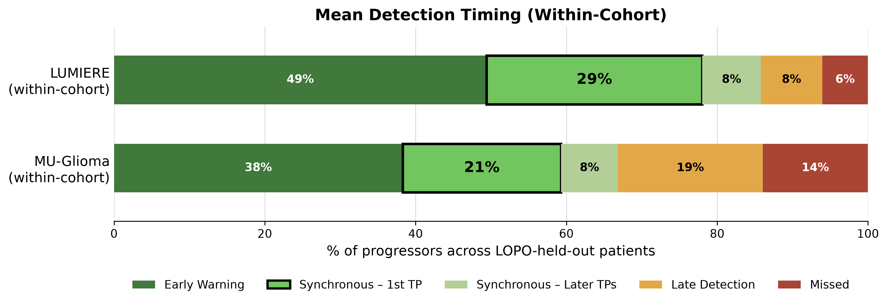
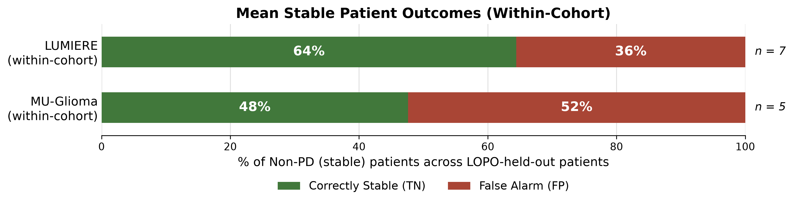
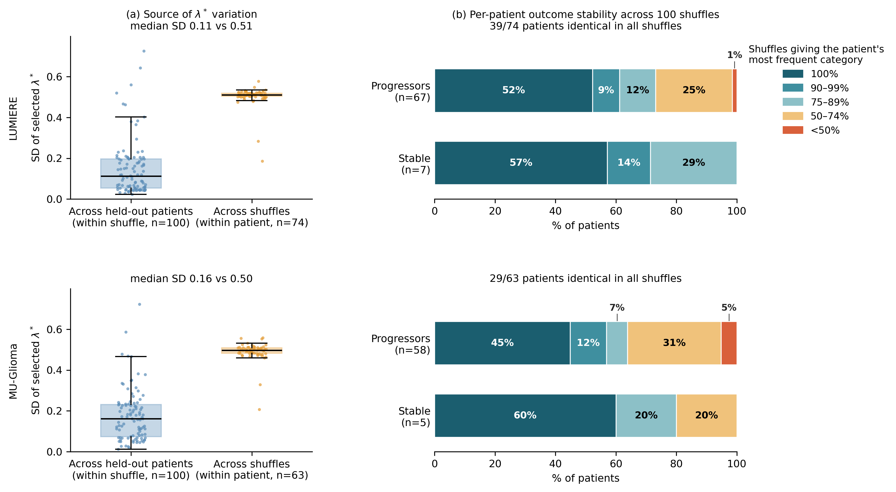
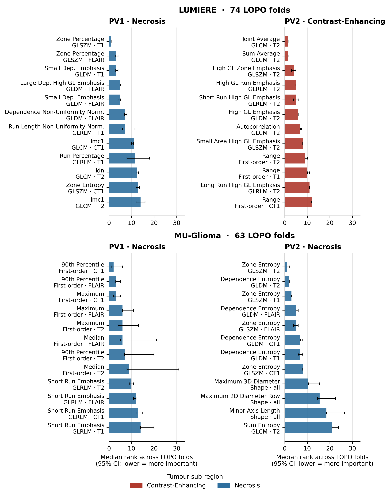

# Modeling Latent Tumor Progression Directions in Glioblastoma

**Early predictions to address RANO evaluations.**

Radiomic drift detection for glioblastoma (GBM). Instead of classifying each follow-up MRI in isolation, we model a patient's movement through a learned latent radiomic space and flag progression when that movement along a *progression direction* exceeds the natural variability of stable patients. The aim is to detect progression at or before the radiologist-assigned RANO progression timepoint.

This repository holds the released results of the paper (per-seed audits, feature-rank statistics, drift trajectories, PCA/direction weights) and the scripts that turn them into the paper's figures.

> **Note on scope.** The pipeline notebooks (feature extraction, LOPO training, λ selection) are **not** in this repository. Everything here is a *result* of that pipeline, plus the figure scripts. The method is described below and in full in the paper (Algorithms 1 and 2).

---

## Highlights

- **Within-cohort, leave-one-patient-out (LOPO)**, averaged over **100 random inner train–validation shuffles**.
- **Timely detection sensitivity** (Early + Synchronous, as a share of all progressors): **85.8 %** on LUMIERE and **66.9 %** on MU-Glioma.
- **Early warnings** (before the radiologist's PD timepoint): 49.4 % of progressors in LUMIERE, 38.3 % in MU-Glioma.
- **Specificity is the main limitation**: 64.4 % (LUMIERE, 7 stable patients) and 47.6 % (MU-Glioma, 5 stable patients).
- Zero-shot vision-language models (MedGemma 1.5, MedMO) did not separate progression from stability reliably on the same task.
- The learned directions are interpretable: in LUMIERE they map onto distinct tumor sub-regions (necrosis vs. contrast-enhancing).

Early triggers are best read as **candidates for retrospective expert review**, not as earlier diagnoses. Without histopathology or long-term follow-up, an early trigger cannot be separated from a false alarm that happened to precede a later PD rating.

---

## Method in brief

For each cohort, radiomic features come from the LUMIERE extraction pipeline: 4 sequences (T1, CT1, T2, FLAIR) × 3 tumor components (Necrosis, Edema, Contrast-Enhancing), giving 1,284 features per scan, reduced to **1,158** after removing 126 sequence-invariant duplicates. All preprocessing below happens inside the LOPO loop (N−1 training patients) to avoid leakage.

1. **Anchoring.** Every follow-up scan is compared with that patient's *most recent Post-Op scan* at or before it. Post-Op scans are anchors only, not evaluation points.
2. **Latent space.** Standardize → signed-log transform → PCA with **3 components**.
3. **Two progression directions.** K-Means (k = 2) on PD scans gives two PD centroids `μ1`, `μ2`; all non-PD scans (Post-Op, SD, PR, CR) form one stable centroid `μST`. Progression vectors are the unit directions `pv_j = (μ_j − μST) / ‖μ_j − μST‖`.
4. **Drift score.** `π*(t) = max_j (z(t) − z(anchor)) · pv_j`, the largest projected displacement from the anchor.
5. **Threshold.** `θ = λ · σST`, where `σST` is the spread of the stable group along the progression directions and `λ` is chosen by patient-level Youden's J in a 2-fold stratified inner CV (grid of 26 values from 0.2 to 2.1, ties go to the smallest λ).
6. **Trigger and audit.** The first scan with `π* > θ` is compared with the first radiologist-rated PD scan and each patient gets a category: *Early*, *Synchronous*, *Late*, *Missed* (progressors) or *True Negative*, *False Positive* (stable patients).
7. **Interpretation.** Directions are back-projected through the PCA loadings to the 1,158-feature space; per-fold feature importance is the absolute weight, averaged over 100 seeds, and consensus ranking uses Robust Rank Aggregation (Kolde et al., 2012) with Benjamini–Hochberg FDR at α = 0.05.

Note that PV1/PV2 numbering comes from K-Means cluster labels and is arbitrary between runs. The figure scripts therefore name each panel by its dominant tumor sub-region.

### Cohorts

| | LUMIERE | MU-Glioma-Post |
|---|---|---|
| Initial pool | 91 patients | 157 glioblastoma patients (of 203 glioma) |
| After inclusion criteria | **74 patients**, 549 sessions | **63 patients**, 262 sessions |
| Progressor : stable | **67 : 7** | **58 : 5** |
| Reference | Suter et al., *Sci Data* 2022 | Yaseen et al., TCIA 2025; Mahmoud et al., *Sci Data* 2025 |

Inclusion: at least 3 MRI sessions; not labeled progressing at the first available timepoint; for MU-Glioma, patients whose documented progression time has no scan on or after it are discarded. For MU-Glioma, features of absent tumor-component masks are set to 0 (treated as absence of the component, not as missing data).

---

## Results

All values are means across 100 shuffles of the inner train–validation split in the N−1 LOPO setting (Table 1 and Table 2 of the paper).

| Outcome (mean ± SD, %) | LUMIERE | MU-Glioma |
|---|---|---|
| Early warning | 49.4 ± 6.2 | 38.3 ± 7.2 |
| Synchronous, first follow-up scan | 28.6 ± 6.4 | 21.0 ± 6.2 |
| Synchronous, later scans | 7.8 ± 1.8 | 7.5 ± 1.7 |
| Late detection | 8.1 ± 6.3 | 19.2 ± 6.2 |
| Missed | 6.1 ± 5.9 | 13.9 ± 8.2 |
| **Timely detection sensitivity** | **85.8** | **66.9** |
| Correctly stable (TN) | 64.4 ± 11.8 | 47.6 ± 14.4 |
| False alarm (FP) | 35.6 ± 11.8 | 52.4 ± 14.4 |

Progressor categories are percentages of all progressors; stable categories are percentages of all stable patients. Because each cohort has only 7 or 5 stable patients, one misclassified patient moves specificity by roughly 14–20 percentage points.




### Stability across folds and shuffles



- `σST` is almost constant across LOPO folds (CV 1.9 % in both cohorts) and does not change across shuffles.
- The selected `λ*` varies mainly with the inner train–validation split, not with the held-out patient. Median SD of `λ*`: 0.11 (LUMIERE) and 0.16 (MU-Glioma) across held-out patients within a shuffle, versus 0.51 and 0.50 across shuffles within a patient. This is why results are averaged over 100 shuffles.
- 39 of 74 LUMIERE patients and 29 of 63 MU-Glioma patients receive the same clinical category in all 100 shuffles.

### Comparison with vision-language foundation models (zero-shot)

Each follow-up scan is queried against the patient's most recent Post-Op scan, as two CE-T1 slices plus a fixed prompt. The table shows the paper's best number per model from its own mask / no-mask ablations.

| | LUMIERE: ours | MedGemma 1.5 | MedMO | MU-Glioma: ours | MedGemma 1.5 | MedMO |
|---|---|---|---|---|---|---|
| Timely sensitivity | 85.8 | 92.6 | 82.1 | 66.9 | 55.2 | 53.4 |
| Specificity | 64.4 | 28.6 | 57.1 | 47.6 | 100.0 | 40.0 |
| Youden's J | **50.2** | 21.2 | 39.2 | 14.5 | 55.2* | −6.6 |
| Missed tumor | 6.1 | 1.5 | 17.9 | 13.9 | 34.5 | 34.5 |

\* MedGemma's MU-Glioma specificity reflects an all-stable default response (without masks it returned the same generic "no change" rationales for stable and progressing scans), not image-grounded discrimination. Hulu-Med and LLaVA-Med are excluded because they predicted "progression" for essentially every scan.

### Which features drive the directions



- **LUMIERE, PV1**: necrosis zone and dependence structure, e.g. `glszm ZonePercentage` and `gldm SmallDependenceEmphasis` (mainly T1 and FLAIR).
- **LUMIERE, PV2**: contrast-enhancing, high-gray-level intensity features (`glcm JointAverage` / `SumAverage`, `glszm HighGrayLevelZoneEmphasis`, `glrlm HighGrayLevelRunEmphasis`), drawn almost entirely from T2.
- **MU-Glioma**: both directions are necrosis-driven. PV1 is first-order intensity (90th percentile, maximum) and PV2 is entropy (`glszm ZoneEntropy`, `gldm DependenceEntropy`) plus shape extent. The lack of a contrast-enhancing direction likely reflects the zero-filling of absent necrosis masks, so directions are not directly interchangeable across cohorts.

---

## Repository layout

```
.
├── feature_ranks.py                       # figure: top features per progression vector
├── gen_lamba_median.py                    # figure: λ* / outcome-stability robustness
├── feature_rank_progression_vectors.{png,pdf}
├── pipeline_robustness_bc.{png,pdf}
│
├── FullAudit_AllSeeds_LUMIERE.csv         # per (seed, patient) audit, 100 × 74
├── FullAudit_AllSeeds_MU-Glioma.csv       # per (seed, patient) audit, 100 × 63
├── AggregateCounts_PerSeed.csv            # LUMIERE category counts per seed
├── AggregateCounts_MeanStd_LUMIERE.csv    # mean/std of those counts
├── SynchronousBreakdown_*.csv             # synchronous detections by MRI position
├── SummaryText_*.csv                      # synchronous totals / 2nd-MRI counts
│
├── RRA_ProgressionVector{1,2}.csv         # Robust Rank Aggregation, LUMIERE (74 folds)
├── RankStability_ProgressionVector{1,2}_{LUMIERE,MU-Glioma}.csv
│                                          # median rank + bootstrap 95% CI per feature
│
├── drift_trajectory_parts/*.parquet       # drift score per scan (LUMIERE)
├── feature_weight_parts/weights_p{1,2}_*.parquet   # back-projected weights per seed/patient (LUMIERE)
├── fold_meta_parts/*.parquet              # λ*, σST, θ, PV/centroid coordinates, EVR, cosines (LUMIERE)
│
└── Overleaf_DIagram/                      # paper detection-timing and stable-outcome figures
    ├── progressor_bar.py, stable_diagram.py
    └── AggregateCounts_MeanStd_*.csv, SynchronousBreakdown_Wide_*.csv, *.png/pdf
```

`_checkpoint_*` files are resume checkpoints and duplicate the LUMIERE audit and count files. `CurationGapBreakdown_*.csv` are empty (`Curation_Gap_Progressors` is 0 in every seed of `SummaryText_PerSeed.csv`). `Thumbs.db` files are Windows artifacts.

### Data dictionary

**`FullAudit_AllSeeds_<cohort>.csv`**

| Column | Meaning |
|---|---|
| `Seed`, `PatientID` | Inner-CV shuffle (0–99) and held-out patient |
| `Is_Progressor` | Patient-level label |
| `Has_PD_Scan_Captured` | Whether the PD-rated scan has imaging captured in the feature table |
| `Clinical_Category` | `Early Warning`, `Synchronous`, `Late Detection`, `Missed Tumor`, `Correctly identified CR/SD`, `False Diagnosis` |
| `Lead_Delay_Weeks` | Lead (positive) or delay (negative) relative to the first PD scan, in weeks |
| `First_PD_Scan_Position` | Index of the first PD-rated scan, as recorded by the pipeline |
| `Threshold`, `Std_St`, `Best_k` | `θ`, `σST`, and the selected `λ*` (named `Best_k` in the files) |

The LUMIERE file additionally has `First_PD_MRI_Overall_Position` and `First_PD_Scans_Since_Anchor`. The MU-Glioma file has trailing summary rows that the scripts drop.

**`RankStability_*.csv`**: `feature, median_rank, ci_95_lower, ci_95_upper, ci_width, p_adj, n_folds`. Feature names follow `original_<family>_<Feature>_<Region>_<Sequence>`.

**`RRA_ProgressionVector*.csv`**: `rho, p_corrected, best_position, median_normalized_rank, mean_normalized_rank, n_folds, p_adj, significant_fdr`. At FDR 0.05, 919 of 1,158 features are significant for PV1 and 969 for PV2.

**Parquet shards** (LUMIERE; read with `pandas.read_parquet`): `drift_trajectory_parts` has `Seed, Patient, Week, Y_Drift, Y_Test_Label, Anchor_Week, Threshold, Best_k`; `feature_weight_parts` has one column per radiomic feature; `fold_meta_parts` has `Seed, Patient, Best_k, Std_St, Threshold, PV1_PC1..3, PV2_PC1..3, Centroid_PC1..3, EVR_PC1..3, Cosine_PV1_PV2_PCspace, Cosine_PV1_PV2_FeatureSpace, Is_Progressor`.

---

## Reproducing the figures

```bash
git clone https://github.com/zawad59/Modeling-Latent-Tumor-Progression-Directions-in-Glioblastoma-Cohort.git
cd Modeling-Latent-Tumor-Progression-Directions-in-Glioblastoma-Cohort

pip install numpy pandas matplotlib
pip install pyarrow            # only needed to read the .parquet files yourself
```

Run each script from the folder that holds its input CSVs:

```bash
# Top features per progression vector  -> feature_rank_progression_vectors.{png,pdf}
python feature_ranks.py

# λ* / outcome-stability robustness     -> pipeline_robustness_bc.{png,pdf}
python gen_lamba_median.py             # optional args: <LUMIERE audit csv> <MU-Glioma audit csv>

# Detection-timing and stable-outcome bars -> Overleaf_DIagram/*.{png,pdf}
cd Overleaf_DIagram
python progressor_bar.py
python stable_diagram.py
```

`gen_lamba_median.py` also prints the stability numbers quoted above, including `σST` CV, the median SD of `λ*`, and the patients with identical categories across shuffles. Running the scripts regenerates the committed figures in place.

Docstrings inside two scripts mention older file names (`feature_rank_figure.py`, `robustness_figure_bc.py`); use the file names above.

---

## Limitations

- Only 7 (LUMIERE) and 5 (MU-Glioma) stable patients, so specificity estimates are coarse and seed-to-seed variable.
- The threshold `λ*` is the least stable component; the learned geometry is stable.
- Labels are RANO ratings, which carry inter-reader variability and cannot separate pseudo-progression from true progression without confirmation.
- Results are within-cohort only; the two cohorts' directions differ and are not interchangeable.
- The VLM comparison is zero-shot and cannot separate a domain gap from sensitivity to prompt and input format.

## Citation

The paper's author list, venue and code link are still placeholders. Please fill in before publishing.

```bibtex
@misc{pseudotime_gbm,
  title  = {Modeling Latent Tumor Progression Directions in Glioblastoma Cohort:
            Early Predictions to Address RANO Evaluations},
  author = {TODO},
  year   = {2026},
  note   = {Code and results: https://github.com/zawad59/Modeling-Latent-Tumor-Progression-Directions-in-Glioblastoma-Cohort}
}
```

Datasets: **LUMIERE**: Suter et al., *Sci Data* 9, 768 (2022), doi:10.1038/s41597-022-01881-7. **MU-Glioma-Post**: Yaseen et al., TCIA (2025), doi:10.7937/7K9K-3C83; Mahmoud et al., *Sci Data* 12, 1847 (2025), doi:10.1038/s41597-025-06011-7. Raw imaging and radiomic inputs are not redistributed here.

## License

No license file is present yet. Add one before others reuse the code or results.
